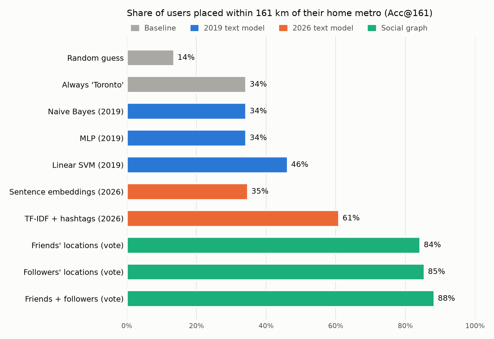

# Geolocation-Prediction

**Where does a Twitter user live? Predicting home cities across Canada from what people tweet and who they follow.**

This is my thesis project from the **University of Ottawa** (2019). In 2026 I rebuilt it from the original research scripts: I fixed the bugs I found along the way, rebuilt it as a reproducible Python package, re-ran every experiment under a stricter evaluation, compared the 2019 models against modern baselines, and added a web demo.

> **Key results** (5-fold cross-validation, 420 users, 41 metros)
> - **88%** of users placed within 161 km of home from **where their friends and followers live**, with no tweet text at all.
> - From **tweets alone**, the rebuilt model reaches **61%** within 161 km (median error **42 km**), up from **46%** (307 km) for the best 2019 model.
> - **7 bugs** found and fixed in the original research code, including one that made every social-graph feature row identical.



**Try it:** `python app/app.py` opens a web demo. Paste a few tweets and see the most likely metros on a map of Canada, with the words that drove the guess ([details](app/README.md)).

## The problem

Fewer than 1% of tweets carry GPS coordinates, but location matters for local news, disaster response, public-health monitoring and regional marketing. The task is to predict a user's home **census metropolitan area** (41 Canadian metros with more than 100k people) or **province** from:

1. **Language:** what they tweet about (teams, transit, weather, slang, French vs English).
2. **Social graph:** where their friends and followers say they live.

Results are reported the way the geolocation literature does: **Acc@161** (share of predictions within 161 km / 100 miles), exact accuracy, and median / mean error distance in km.

## Data

Two datasets collected for the thesis and [published separately](https://github.com/mertmetin/Canadian-Twitter-users-and-tweets-datasets):

| Dataset | Contents |
|---|---|
| **Twitter-CAD-Users** | 420 users labelled with their home metro, ~1M of their tweets, and up to 100 friends and 100 followers each with their declared location |
| **Twitter-CAD-Tweets** | 42k geotagged tweets from the same 41 metros |

The data is not stored in this repository. `geoloc download` fetches it (~75 MB).

## Results

Every user-level number comes from **5-fold cross-validation**: every user is predicted once by a model that never saw them. The thesis used one 80/20 split, so only 84 test users, and several metros have just two users. That split is still reported in [`results/summary.md`](results/summary.md) for comparison.

**Predicting a user's metro (41 classes)**

| Approach | Exact | Acc@161 | Median error |
|---|---:|---:|---:|
| Random guess | 2% | 14% | 1,009 km |
| Always "Toronto" (largest class) | 24% | 34% | 466 km |
| 2019: TF-IDF + Multinomial NB | 24% | 34% | 466 km |
| 2019: hashed TF-IDF + MLP | 24% | 34% | 466 km |
| 2019: TF-IDF + linear SVM | 36% | 46% | 307 km |
| 2026: multilingual sentence embeddings + logistic regression | 26% | 35% | 466 km |
| **2026: word + hashtag TF-IDF + logistic regression** | **49%** | **61%** | **42 km** |
| Friends' declared locations, majority vote | 79% | 84% | 0 km |
| Followers' declared locations, majority vote | 80% | 85% | 0 km |
| **Friends + followers, majority vote** | **83%** | **88%** | **0 km** |

At **province** level the 2026 text model gets 72% exactly right (2019 SVM: 55%; always-Ontario: 40%).

Full tables (province level, single tweets, every model): [`results/summary.md`](results/summary.md).

### What the numbers say

- **Who you follow beats what you say.** A plain majority vote over friends' and followers' declared locations places 88% of users within 161 km, and needs no training. It only became visible after fixing the 2019 bug that gave every user identical social features.
- **Local vocabulary is the text signal.** The best text model's strongest Ottawa features are `ottawa`, `rideau`, `carleton`, `oc transpo`, `kanata` and `gatineau`; for Toronto they are `ttc`, `yonge`, `scarborough`, `bloor` and `tiff`. Requiring every term to be used by at least 5 different people helped (61% vs 53% with rarer terms allowed): it filters noise from 420 very chatty users.
- **Generic sentence embeddings barely beat the baseline.** Averaging a user's tweet embeddings captures *what* they talk about (sports, food, politics), which is similar across Canadian cities, and smooths away the place names that carry location. Bigger is not automatically better.
- **Two of the 2019 models never learned anything.** Naive Bayes and the MLP predict "Toronto" for everyone, so their accuracy equals the majority baseline. The thesis's single 84-user test split made that easy to miss; cross-validation with a majority baseline next to every model makes it obvious.
- **Single tweets are hard, and random splits flatter them.** From one tweet, no model clearly beats the baseline (best 37% within 161 km vs 35%). With the thesis's random split, which lets a person's other tweets into training, the 2019 SVM scores 44%; with whole users held out it drops to 36%. Part of the 2019 number was the model recognising people, not places.

## What I fixed from the 2019 code

The original scripts live unchanged in [`legacy/`](legacy/). Revisiting them turned up these bugs. All are fixed, and the ones that could come back (shared counts, label spellings, the parser) have tests:

| Bug | Effect | Fix |
|---|---|---|
| `sql + where` in `Tweets.get_users` built the metro filter but threw it away | The label filter never ran; every user was loaded regardless of the metro list | Data now loads from Parquet with explicit filtering |
| `cpy = D` in the social-graph scripts copied a **reference**, not the dictionary | Every user shared one count dictionary, so all feature rows were identical and the classifier could only learn the class prior | A fresh `Counter` per user ([`social.py`](src/geoloc/social.py)) |
| Quebec City spelled three ways (`Quebec City`, `Québec City`, `Québec metro`) across scripts | Its 13 users silently fell out of some experiments | One canonical label set with alias folding ([`labels.py`](src/geoloc/labels.py)) |
| `clean_doc` re-joined words with `''` rather than `' '` | The CNN saw each user's tweets as one giant word | Dropped in favour of standard tokenizers |
| Tweet-level split was random over tweets | The same person's tweets were in train and test, so models could memorise people, not places | Splits are grouped by user |
| GloVe matrix built but never passed to the model; `binary_crossentropy` on a softmax over 41 classes | The "GloVe CNN" was neither | Replaced by a sentence-embedding baseline |
| Longitudes stored as positive numbers | Distances happened to be right, but nothing could be mapped | Signed coordinates |

Other modernisation work:
- **No database:** a streaming parser reads the MySQL dumps directly into Parquet, so you don't need MySQL or a root password.
- **Removed APIs:** `predict_classes`, `keras.layers.embeddings`, `load_boston` and GeoText are gone.
- **Location parser:** a Canadian-aware parser for free-text locations handles "the 6ix", "YYC", "Montréal 🇨🇦" and Mississauga → Toronto, and rejects "London, England".
- **Tooling:** one package, one CLI, pinned evaluation protocol, tests and lint.

## Run it

```bash
uv venv -p 3.12 && uv pip install -e ".[dev,embeddings]"
geoloc download          # ~75 MB from the thesis Dropbox
geoloc prepare           # SQL dumps -> Parquet (~40 s)
geoloc users-social      # social-graph models (seconds)
geoloc users-text        # text models, metro + province (~20 min)
geoloc tweets-text       # single-tweet models
geoloc users-embed       # sentence embeddings (downloads a ~470 MB model)
geoloc report            # results/summary.md + results/acc161.png
pytest
```

### Web demo

```bash
uv pip install -e ".[app]"
geoloc train-demo        # fits the demo model on all users (~2 min)
python app/app.py        # http://localhost:7860
```

`scripts/run_all.sh` runs everything in order.

### Optional: zero-shot LLM baseline

`geoloc llm` asks Claude to pick a metro from a user's 300 most recent tweets, with no training. The answer is constrained to the 41 labels with structured outputs, and responses are cached. It needs an Anthropic API key, which is billed separately from Claude subscriptions, and isn't included in the results above.

```bash
pip install -e ".[llm]"
ANTHROPIC_API_KEY=... geoloc llm --level user
```

## Layout

```
src/geoloc/
  data.py         SQL dump parser, Parquet loaders
  labels.py       41 metros, 10 provinces, aliases, coordinates
  social.py       declared-location parser, neighbour location counts
  models.py       2019 configurations and 2026 baselines
  embeddings.py   multilingual sentence-embedding classifier
  llm.py          optional zero-shot Claude baseline
  experiments.py  evaluation protocols (CV, grouped CV, 2019 split)
  metrics.py      Acc@161, error distance
  report.py       tables and figure
  demo_model.py   trains the model behind the web demo
app/              Gradio web demo (Hugging Face Spaces ready)
legacy/           the original 2019 scripts, unchanged
results/          JSON results, summary.md, acc161.png
tests/            parser, labels, social features, metrics, demo
```

## Citation

If you use the datasets, please cite or link the [dataset repository](https://github.com/mertmetin/Canadian-Twitter-users-and-tweets-datasets).

## License

MIT
